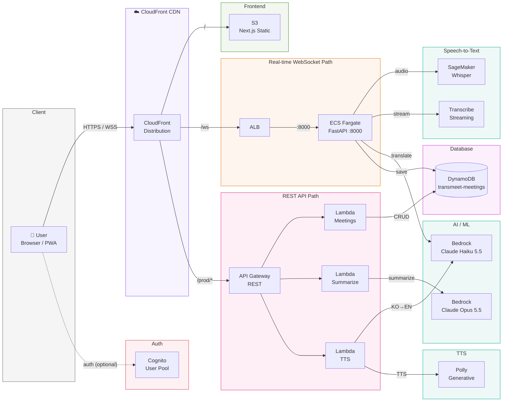

# TransMeet

글로벌 미팅에서 영어가 들릴 때, 바로 한글 자막이 뜨고 — 내가 한글로 입력하면, 영어 음성이 나간다.

TransMeet은 **실시간 음성 번역 웹앱**입니다. 영어 화자의 발화를 Whisper/Transcribe로 인식하고, Bedrock Claude로 즉시 한글 번역을 스트리밍합니다. 반대로 한글 텍스트를 입력하면 Polly가 자연스러운 영어 음성으로 변환해줍니다. 화자를 자동으로 구분하고, 대화 내용을 AI로 요약하며, 모든 회의 기록을 저장합니다.

브라우저만 열면 됩니다. PWA로 모바일에서도 설치 없이 사용할 수 있습니다.

처음 사용한다면 [사용 가이드](https://archive.hi-yoo.com/transmeet/guide/)부터 열어 보세요. 메뉴마다 어떤 버튼을 누르는지 스크린샷과 함께 설명하고, 설정 항목도 하나씩 다룹니다. 인터넷 없이 읽을 파일 하나짜리 버전은 [`public/guide/index.html`](public/guide/index.html)에 있습니다. 두 가이드를 만드는 방법은 [사용 가이드와 공유 문서](#사용-가이드와-공유-문서)를 참고하세요.

### 주요 시나리오

- 🎙️ 영어 회의 참석 → 실시간 한글 자막으로 내용 파악
- ✍️ 한글로 의견 입력 → 영어 음성으로 회의에 참여
- 📋 회의 종료 → AI 요약으로 핵심 내용 정리
- 🔄 빠른 번역 팝업 → 회의 중 즉석으로 단어/문장 번역

## Features

- **STT 엔진 선택** — Whisper large-v3-turbo / Amazon Transcribe / Qwen3-ASR / Nemotron 3.5 ([한국어·영어 비교·설정 가이드](docs/stt-models.md)). Qwen과 Nemotron은 모델 복제본을 각각 1개 유지해 재기동 대기를 줄입니다.
- **Transcribe 언어 토글** — 영어/한글 전환 가능 (Transcribe 모드)
- **실시간 번역** — 영어 ↔ 한글 양방향 번역 (Bedrock Haiku 5.5 / GPT-6 Luna 선택)
- **스트리밍 번역** — 번역 진행 중 부분 텍스트 실시간 표시
- **화자 구분** — Speaker Diarization으로 화자별 메시지 분리
- **대화 요약** — 자세하게 / Amazon 미팅록 / 의사결정 기록 / 공유·보고용 선택, 자동·수동 생성
- **빠른 번역** — 글로벌 팝업으로 한→영 즉석 번역 + 번역 히스토리 관리
- **한→영 TTS** — 한글 입력 → 영어 음성 출력 (Polly Generative/Neural/Standard)
- **회의 기록** — 생성, 조회, 삭제 + 자동 제목 생성
- **회의 한 줄 요약** — 제목 아래에 회의 전체의 핵심·결론 표시. 새 대화 20개마다 갱신하며, 제목 및 상세 자동 요약 설정과 별도로 동작
- **설정 패널** — 오디오 소스, STT 프로바이더, 번역 타이밍, Polly 엔진 등 커스터마이징
- **인증** — AWS Cognito 기반 관리자 초대제 로그인, 비밀번호 변경·복구 (선택)
- **테마 설정** — 시스템/라이트/다크, 오렌지 등 포인트 색상 6종, 글꼴 4종, 화면·말풍선 크기와 줄 간격 조절
- **PWA** — 모바일 설치 가능, 오프라인 UI 지원

## Tech Stack

- **Frontend:** Next.js 14 (App Router, Static Export, PWA)
- **STT:** AWS SageMaker (Whisper large-v3-turbo, Qwen3-ASR-1.7B, Nemotron 3.5 ASR 0.6B) / Amazon Transcribe
- **Translation/Summary:** AWS Bedrock — 번역 Claude Haiku 5.5(또는 GPT-6 Luna), 내 메모 Q&A Claude Sonnet 5.5, 요약·회의 페이지 Claude Opus 5.5(폴백 Opus 5). 모두 `global.` 추론 프로필
- **Meeting Page Agent:** LangGraph + Amazon Bedrock AgentCore Runtime
- **TTS:** AWS Polly (Generative / Neural / Standard)
- **WebSocket:** ECS Fargate + ALB + CloudFront
- **Database:** AWS DynamoDB (회의·대화·페이지·요약 양식 테이블 분리)
- **Auth:** AWS Cognito
- **Hosting:** AWS S3 + CloudFront
- **IaC:** AWS CDK (TypeScript)

## Getting Started

```bash
# Install dependencies
npm install

# Copy environment variables
cp .env.example .env.local

# Run development server
npm run dev

# Build for production
npm run build

# Lint & format
npm run lint
npm run format
```

### 테마 변경

상단의 **설정 → 테마**에서 색상, 글꼴, 화면 크기(90–120%), 말풍선 글자 크기와 본문 줄 간격을 바꿀 수 있습니다. 포인트 색상으로 **오렌지**를 선택하면 버튼, 선택 표시, 요약 제목 등이 함께 바뀝니다.

변경사항은 즉시 적용되며 브라우저에 저장됩니다. 헤더의 라이트/다크 전환도 같은 설정을 사용합니다. **테마 초기화**는 화면 관련 설정만 되돌리며 음성·번역 설정은 유지합니다.

테마·번역 모델 저장값 검증과 초기 화면 적용 테스트는 Node.js 22.6 이상에서 `npm run test:settings`로 실행합니다.

### 번역 모델

**설정 → 음성 · 번역**에서 두 모델을 선택할 수 있습니다. 기본값은 Haiku 5.5입니다.

- **Haiku 5.5:** `global.anthropic.claude-haiku-5-5`
- **GPT-6 Luna:** `global.openai.gpt-6-luna`

두 모델 모두 Bedrock 글로벌 추론 프로필을 사용합니다. 이전 Nova 모델 선택은 Haiku 5.5로 정리됩니다. 프로필·호출 검증 기록은 [번역 모델 검증](docs/translation-models.md)을 참고하세요.

### 요약 방식

요약 패널 상단의 **요약 방식**에서 회의별로 선택합니다. 기본값은 **자세하게**이며, 기존 상세 회의록 구성과 자동 요약 시점은 그대로 유지됩니다.

| 방식 | 구성 |
|---|---|
| 자세하게 (기본) | 한눈에 보기, 회의 요약, 논의 흐름, 결정, 액션 아이템, 미결 사항 |
| Amazon 미팅록 | 요약(BLUF), 고객 요구, 주요 논의, 결정, 액션 아이템(Owner/Due), 리스크·미결 |
| 의사결정 기록 | 결정별 맥락·검토한 대안·선택 이유·트레이드오프·재검토 조건, 보류된 결정, 결정에 따른 할 일 |
| 공유·보고용 | 서술형 보고문: 요약, 배경, 결정 사항, 향후 일정 |

선택은 회의에 저장되며, 바꾸는 즉시 요약을 다시 생성하지는 않습니다. **요약 생성/새로 생성**, 자동 요약, 회의 종료 시 요약과 메일에 같은 선택이 적용됩니다. 다른 방식으로 다시 생성할 때도 원본 대화를 사용합니다. 기존 요약에는 실제 생성된 방식이 표시됩니다. 한 줄 요약과 별도 회의 페이지는 이 선택의 영향을 받지 않습니다.

프롬프트는 `backend/app/summary_styles.json`에 정의하며 WebSocket과 REST 경로가 함께 사용합니다. 검증은 `npm run test:summary`와 `cd backend && python -m pytest`로 실행합니다.

## Project Structure

```
src/
  app/
    layout.tsx                  # Root layout (PWA metadata, theme)
    page.tsx                    # Main page (상태 관리, WebSocket, 오디오 처리)
    globals.css                 # Global styles + Tailwind
  components/
    Header.tsx                  # 상단바 (녹음 상태, 테마 토글, 빠른 번역/요약 토글)
    VoiceArea.tsx               # 음성 입력 메시지 표시 (화자별 트랜스크립트 카드)
    NotesArea.tsx               # 내 메모 및 번역 결과 목록
    NotesComposer.tsx           # 내 메모 패널 하단 입력·전송
    ChatArea.tsx                # 채팅 뷰
    ControlPanel.tsx            # 플로팅 녹음 버튼 및 종료·다운로드 메뉴
    MeetingSidebar.tsx          # 회의 목록 & 생성
    SummaryPanel.tsx            # 요약 표시 (Markdown 렌더링 + 복사 + 글자 크기 조절)
    QuickTranslatePopup.tsx     # 글로벌 빠른 번역 팝업 (스트리밍 + 히스토리)
    SettingsPanel.tsx           # 앱 설정 패널
    SttStatusPanel.tsx          # STT 엔진 준비 상태·엔진 준비 버튼
    EmailNotifySetting.tsx      # 회의 종료 메일 수신 설정·인증
    SummaryTemplateSettings.tsx # 내 요약 양식 관리
    MeetingPagePanel.tsx        # 회의 페이지 생성·미리보기·공유
    AuthScreen.tsx              # 초대 계정 로그인·최초 비밀번호 설정
    PasswordResetForm.tsx       # 이메일 인증 코드로 비밀번호 복구
    AccountSettings.tsx         # 계정 이메일 인증·비밀번호 변경
    MobileTabBar.tsx            # 모바일 탭 네비게이션
    SubtitleArea.tsx            # 자막 표시 (레거시)
    ThemeProvider.tsx           # 테마 상태·저장·시스템 모드 동기화
    ThemeSettings.tsx           # 색상·글꼴·크기 설정 및 미리보기
  hooks/
    useWebSocket.ts             # WebSocket 연결 관리 (재연결, keepalive)
    useAudioCapture.ts          # 오디오 캡처 (마이크/시스템/둘 다)
    useSettings.ts              # localStorage 기반 설정 관리
    useQuickTranslateHistory.ts # 빠른 번역 히스토리 관리
    useSummaryResize.ts         # 요약 패널 리사이즈 핸들러
    usePanelResize.ts           # 좌우 패널 드래그·키보드 너비 조절 및 저장
    useInterval.ts              # 유틸리티 훅
  lib/
    api.ts                      # REST API 클라이언트
    websocket.ts                # WebSocket 메시지 타입 정의
    cognito.ts                  # Cognito 인증 유틸리티
    theme.ts                    # 테마 기본값·검증·첫 화면 초기화
  context/
    AuthContext.tsx              # 인증 상태 Context
  types/
    meeting.ts                  # Message, Meeting, SpeakerRole 타입
backend/
  app/
    main.py                     # FastAPI 앱 엔트리포인트
    ws_handler.py               # WebSocket 오디오 파이프라인
    models.py                   # Pydantic 메시지 모델
    config.py                   # 환경 설정
    aws_clients.py              # AWS SDK 컨텍스트 매니저
    transcribe_session.py       # Amazon Transcribe 스트리밍 세션
    message_store.py            # 회의 대화 읽기/쓰기 (transmeet-messages)
    summary_prompt.py           # 요약 프롬프트 (summary_styles.json 공유)
    page_agent.py               # 회의 페이지 에이전트 Runtime 호출·중계
    mailer.py                   # 회의 종료 메일
  Dockerfile                    # Python 3.12 컨테이너
  requirements.txt              # Python 의존성
agent/                          # 회의 페이지 에이전트 (아래 섹션 참고)
infra/                          # AWS CDK
docs/
  guide/                        # 온라인 사용 가이드 + 캡처·업로드 스크립트
  user-guide/                   # 오프라인 가이드 생성기 (→ public/guide)
benchmarks/                     # STT 비교 결과
public/
  manifest.json                 # PWA manifest
  icons/                        # App icons
  guide/index.html              # 오프라인 사용 가이드 (생성물)
```

## 회의 종료 메일

설정에서 **회의 종료 시 메일로 받기**를 켜면 필요한 이메일 인증이 시작됩니다.

1. 계정 이메일이 아직 확인되지 않았다면, 메일로 받은 **6자리 인증 코드**를 설정 화면에 입력합니다.
2. 계정 확인이 끝나면 **수신 인증 메일**을 자동으로 보냅니다. 해당 메일의 링크를 한 번 눌러 주세요.
3. 설정으로 돌아오면 **인증 완료**로 갱신됩니다. 필요하면 **인증 상태 확인**을 누를 수 있습니다.

이미 인증된 단계는 건너뜁니다. 코드가 만료되었거나 메일이 도착하지 않으면 설정 안에서 다시 받을 수 있습니다. 인증 대기 중에는 메일이 발송되지 않으며, 옵션은 기본적으로 꺼져 있습니다.

메일의 요약 표는 HTML 표로 표시합니다. 발송 시점에 회의 페이지가 이미 발행되어 있으면 **회의 페이지 보기** 링크도 함께 보냅니다. 페이지가 생성 중이거나 아직 없으면 요약과 기존 미팅 화면 링크를 먼저 보내며, 페이지 생성을 기다리느라 메일을 지연하지 않습니다.

현재 SES 샌드박스 환경에서는 계정 이메일 확인과 수신 주소 인증이 모두 필요합니다. 계정 인증 후에는 로그인 토큰과 연결된 회의의 인증 정보를 갱신하므로 로그아웃하거나 녹음을 중단할 필요가 없습니다. 설정을 다시 열거나 인증 상태를 자동 조회할 때에는 인증 메일을 재발송하지 않습니다.

검증: `npm run test:email`, `python3 tests/email_verification_browser.py` — 브라우저 테스트는 외부 인증·메일 요청을 가로채므로 실제 메일을 보내지 않습니다.

## 미팅 페이지 에이전트 (LangGraph + AgentCore Runtime)

미팅 기록으로 공유용 HTML 미팅록 페이지를 만드는 에이전트입니다. 설계: [`docs/superpowers/specs/2026-10-09-meeting-page-langgraph-runtime-design.md`](docs/superpowers/specs/2026-10-09-meeting-page-langgraph-runtime-design.md) (초기 하네스 설계는 [2026-10-08 문서](docs/superpowers/specs/2026-10-08-meeting-page-agent-design.md))

- **구성**: `agent/runtime/`의 LangGraph 그래프를 AgentCore Runtime(`transmeet_meeting_page`, ARM64 컨테이너)에서 실행 · Claude Opus 5.5(폴백 Opus 5) · Web Search(AgentCore Gateway 커넥터). 백엔드 `page_agent.py`는 Runtime 스트림을 WebSocket `page_stream`으로 전달합니다
- **페이지 모양**: 시각 회의록(`visual`, 기본)과 상세 회의록(`detailed`)
- **발행**: 에이전트가 `publish_page`를 호출하면 백엔드가 검증 후 S3에 올리고 `https://transmeet.hi-yoo.com/p/<meetingId>/<pageId>.html`로 공개
- **UI**: 우측 패널 `회의 페이지` 탭 → 생성 · 미리보기 · 공유 · 재생성 · 공유 해제
- **자동 생성**: `회의 종료`를 누르면 마지막 발언 저장과 제목 준비 후 **시각 회의록**을 기본으로 자동 생성하고 페이지 패널에 진행 상황과 결과를 표시합니다. 오디오 정리·요약 완료를 기다리지 않으며, 메일 발송 설정과 무관하게 동작합니다. 이미 생성 중이거나 발행된 페이지는 재사용합니다. 내용을 갱신하거나 이전 형식을 시각 회의록으로 바꾸려면 `다시 만들기`를 누르세요.

최근 14일의 기존 미팅을 시각 회의록으로 일괄 생성하려면 저장소 루트에서 아래 명령을 실행합니다. 기간은 미팅 생성 시각을 기준으로 하며, 이미 시각 회의록인 페이지와 대화가 없는 미팅은 건너뜁니다. 기존 페이지와 링크 기록은 `agent/.page-backup/`에 백업하고 결과를 JSON으로 남깁니다. 재생성한 페이지는 새 공유 링크를 사용합니다.

```bash
python3 backend/scripts/backfill_visual_pages.py --user-id <계정-ID>          # 대상 확인
python3 backend/scripts/backfill_visual_pages.py --user-id <계정-ID> --apply  # 생성
```

`--since`, `--until`로 ISO 8601 기간을 지정할 수 있습니다. 시간대가 없는 값은 UTC로 해석합니다. 기본적으로 최대 4건을 병렬로 생성하며 `--concurrency`로 조절할 수 있습니다. 모든 계정을 명시적으로 포함하려면 `--user-id` 대신 `--all-users`를 사용합니다.

```
agent/
  runtime/             LangGraph 그래프(graph.py)·단계별 프롬프트(prompts/)·시각 회의록(visual.py)·발행(publish.py)
  skills/              단계에서 참고하는 미팅록·리서치·인사이트·도해 지침
  samples/, evals/     평가용 샘플과 프롬프트
  scripts/             invoke_local.py(--direct 로컬 실행 / --runtime 배포본 호출) · invoke_batch.py(일괄 재생성)
  Dockerfile           Runtime 이미지 (cdk deploy 가 빌드·푸시)
```

### 배포 순서

백엔드 이미지는 `deploy.sh` 범위 밖이므로 직접 빌드합니다. **고유 태그로 푸시**하고 그 태그로 CDK를 배포하세요. `latest`를 푸시한 뒤 강제 재배포하면 태스크 정의가 가리키는 예전 태그 이미지가 다시 뜹니다.

```bash
TAG=$(git rev-parse --short HEAD)-$(date +%Y%m%d%H%M)
aws ecr get-login-password --region us-east-1 | docker login --username AWS --password-stdin <WsBackendEcrUri 호스트>
docker build --platform linux/amd64 -t <WsBackendEcrUri>:$TAG backend && docker push <WsBackendEcrUri>:$TAG

# 백엔드 태그 지정 + 에이전트 Runtime 이미지·Gateway·버킷 반영
cd infra && npx cdk deploy -c wsImageTag=$TAG --require-approval never --outputs-file outputs.json && cd ..
./deploy.sh frontend
```

- `-c wsImageTag` 없이 `./deploy.sh infra`를 실행하면 태그가 `latest`로 돌아갑니다.
- 에이전트 Runtime 이미지를 특정 버전으로 고정하려면 `-c agentImageUri=<이미지 URI>`를 함께 넘깁니다.
- `--platform linux/amd64`를 빼면 Fargate 태스크가 기동하지 못합니다. 에이전트 이미지는 ARM64라서 CDK가 빌드할 때 qemu binfmt가 필요합니다.

통합 확인은 `agent/.venv/bin/python agent/scripts/invoke_local.py --direct --sample agent/samples/short-1on1.json`로 합니다. 전체 그래프를 로컬 프로세스에서 실행해 실제 Bedrock·S3·DynamoDB로 페이지를 발행합니다(약 4~5분). 배포된 Runtime을 호출하려면 `--direct` 대신 `--runtime`을 씁니다.

## 사용 가이드와 공유 문서

가이드는 두 가지이며 용도가 다릅니다.

| 가이드 | 위치 | 용도 |
|---|---|---|
| 온라인 사용 가이드 | `docs/guide/` → https://archive.hi-yoo.com/transmeet/guide/ | 링크로 공유. 22개 섹션, 스크린샷 38장, 목차 검색 |
| 오프라인 가이드 | `docs/user-guide/` → `public/guide/index.html` | CSS·이미지를 넣은 파일 하나. 인쇄·PDF용 ([작성 안내](docs/user-guide/README.md)) |

온라인 가이드의 스크린샷은 `docs/guide/capture/capture.py`가 Playwright로 찍습니다. REST·WebSocket·Cognito를 가짜 응답으로 대신하고 `capture/mock_data.py`의 예제 회의만 쓰므로, 실제 계정이나 회의 내용이 화면에 나오지 않습니다.

```bash
# 1) 가짜 엔드포인트로 개발 서버 실행
NEXT_PUBLIC_API_ENDPOINT=https://api.guide.test NEXT_PUBLIC_WS_ENDPOINT=wss://ws.guide.test \
NEXT_PUBLIC_COGNITO_USER_POOL_ID=us-east-1_GUIDE0000 NEXT_PUBLIC_COGNITO_CLIENT_ID=guideclient000 \
NEXT_PUBLIC_COGNITO_REGION=us-east-1 npx next dev -p 3311

# 2) 스크린샷 다시 찍기 (인자로 파일명 일부를 주면 해당 화면만)
python3 docs/guide/capture/capture.py [이름]

# 3) 가이드·STT 비교 리포트 업로드 + CloudFront 무효화
docs/guide/publish.sh
```

- 캡처 브라우저는 `capture/fonts.conf`로 한글 글꼴을 Noto Sans KR로 고정합니다. 서버 기본 글꼴(WenQuanYi)을 쓰면 자간이 깨져 보입니다.
- `publish.sh`는 아래 문서를 올립니다.
  - `/transmeet/guide/`: 온라인 사용 가이드
  - `/transmeet/stt-benchmark/`: [서울 리전 STT 스트리밍 비교](https://archive.hi-yoo.com/transmeet/stt-benchmark/) 리포트
  - `/transmeet/`: 문서 목록 페이지
- `archive.hi-yoo.com`(비공개 S3 + CloudFront OAC)은 TransMeet CDK 스택과 별도로 만든 공용 아카이브입니다. `deploy.sh`나 `cdk deploy`가 건드리지 않습니다. 공개 링크이므로 계정 ID, 엔드포인트, 실제 회의 내용이 없는지 확인한 뒤 올리세요.

## Architecture

> draw.io 상세 다이어그램: [`docs/transmeet-architecture.drawio`](docs/transmeet-architecture.drawio)



### WebSocket 메시지 흐름

**Inbound (Client → Server):**

| Action | 설명 |
|--------|------|
| `sendAudio` | Base64 WAV 오디오 청크 전송 |
| `startRecording` | 녹음 시작 (meetingId, speaker, sttProvider 등 설정) |
| `stopRecording` | 녹음 중지 |
| `ping` | Keepalive |
| `summarize` | 요약 생성 요청 |
| `ttsRequest` | 한→영 TTS 요청 |
| `translateMessage` | 빠른 번역 요청 |

**Outbound (Server → Client):**

| Type | Phase | 설명 |
|------|-------|------|
| `subtitle_stream` | `stt_partial` | STT 부분 결과 |
| `subtitle_stream` | `stt` | STT 최종 결과 |
| `subtitle_stream` | `translating` | 번역 진행 중 (스트리밍) |
| `subtitle_stream` | `done` | 번역 완료 |
| `summary_stream` | `chunk` / `done` | 요약 스트리밍 |
| `tts_stream` | - | TTS 오디오 응답 |
| `pong` | - | Keepalive 응답 |

## Infrastructure (AWS CDK)

인프라는 `infra/` 폴더에 AWS CDK (TypeScript)로 구성되어 있습니다.

### AWS Resources

| 리소스 | 이름 | 용도 |
|--------|------|------|
| ECS Fargate | `transmeet-ws-cluster` | WebSocket 백엔드 (실시간 오디오 스트리밍) |
| ECR | `transmeet-ws-backend` | WebSocket 백엔드 컨테이너 이미지 |
| ALB | - | ECS 로드밸런싱 |
| API Gateway REST | `transmeet-api` | 회의 CRUD, 요약, TTS |
| Lambda | `transmeet-meetings` | 회의 생성/조회/삭제/제목 생성 |
| Lambda | `transmeet-summarize` | Bedrock Claude 요약 생성 (WebSocket 경로의 폴백) |
| Lambda | `transmeet-tts` | Bedrock 번역 + Polly TTS |
| DynamoDB | `transmeet-meetings` | 회의 정보(제목·요약·설정) |
| DynamoDB | `transmeet-messages` | 회의 대화(발언) |
| DynamoDB | `transmeet-pages` | 회의 페이지 발행 기록 |
| DynamoDB | `transmeet-summary-templates` / `-snapshots` | 내 요약 양식과 회의별 사본 |
| AgentCore | Runtime `transmeet_meeting_page` + Gateway | 회의 페이지 에이전트와 Web Search |
| S3 | `transmeet-frontend-{account}` | 프론트엔드 정적 호스팅 |
| CloudFront | - | CDN 배포 + WebSocket `/ws` 라우팅 |
| Cognito | `transmeet-users` | 사용자 인증 (선택) |

### REST API Endpoints

```
POST   /meetings                 # 회의 생성
GET    /meetings                 # 회의 목록
GET    /meetings/{id}            # 회의 상세
DELETE /meetings/{id}            # 회의 삭제
POST   /meetings/{id}/summarize  # 요약 생성
PUT    /meetings/{id}/summary-style  # 회의별 요약 방식 저장
POST   /meetings/{id}/title      # 자동 제목 생성
POST   /tts                      # 한→영 번역 + TTS
```

### WebSocket

CloudFront `/ws` 경로를 통해 ECS Fargate 백엔드에 WebSocket 연결합니다.

```
Client → wss://{CloudFront}/ws → ALB → ECS Fargate (포트 8000)
```

### Deploying Infrastructure

```bash
# Prerequisites
npm install -g aws-cdk
aws configure  # AWS credentials 설정

# CDK bootstrap (최초 1회)
cd infra && npx cdk bootstrap

# 인프라만 배포
./deploy.sh infra

# 프론트엔드만 배포
./deploy.sh frontend

# 인프라·프론트엔드 배포 (백엔드 이미지 빌드·푸시는 위 순서 참고)
./deploy.sh all

# 변경사항 미리 보기
./deploy.sh diff

# 인프라 삭제
./deploy.sh destroy
```

### Infrastructure Directory

```
infra/
  bin/
    transmeet.ts        # CDK app entry point
  lib/
    transmeet-stack.ts  # Main CDK stack
  lambda/
    meetings/           # CRUD + 제목 생성
    summarize/          # 요약 생성 (Claude Opus 5.5)
    tts/                # 한→영 번역 + Polly TTS
  package.json
  tsconfig.json
  cdk.json
```

### 초대 계정과 비밀번호 관리

공개 회원가입은 Cognito 사용자 풀에서 차단합니다. 승인한 사용자만 관리자가 계정을 생성해 초대합니다.

1. AWS 콘솔에서 Cognito → `transmeet-users` → 사용자 생성으로 이동합니다.
2. 승인한 사용자의 이메일을 입력하고 **초대 이메일 전송** 및 **임시 비밀번호 자동 생성**을 선택합니다.
3. 사용자는 초대 메일의 접속 주소와 임시 비밀번호로 로그인하고 본인 비밀번호를 설정합니다.
4. 로그인 후 **설정 → 계정**에서 이메일을 인증합니다. 인증된 이메일로만 비밀번호를 복구할 수 있습니다.

현재 임시·일반 비밀번호 정책은 **최소 8자**이며, 대문자·소문자·숫자·특수문자 포함은 필수가 아닙니다.
임시 비밀번호는 **7일** 동안 유효합니다. 만료되었다면 관리자가 초대를 재전송해 새 임시 비밀번호를 발급합니다.
사용자의 이메일 소유권을 확인하지 않고 `email_verified` 속성을 임의로 설정하지 않습니다.

CLI로 초대할 때도 `--temporary-password`를 생략하면 Cognito가 정책에 맞는 임시 비밀번호를 자동 생성하고 이메일로 보냅니다.
`USER_POOL_ID`는 CDK 배포 결과의 `UserPoolId`를 사용합니다.

```bash
aws cognito-idp admin-create-user \
  --region us-east-1 \
  --user-pool-id "$USER_POOL_ID" \
  --username "approved@example.com" \
  --user-attributes Name=email,Value=approved@example.com \
  --desired-delivery-mediums EMAIL
```

- 로그인 상태에서 변경: **설정 → 계정 → 비밀번호 변경**. 현재 비밀번호를 확인하고 변경하며, 진행 중인 회의는 유지합니다.
- 비밀번호 분실: **로그인 → 비밀번호 찾기**. 이메일의 인증 코드와 새 비밀번호를 입력한 뒤 다시 로그인합니다.
- 초대 메일만 받은 상태이거나 이메일을 아직 인증하지 않았다면, 복구 대신 관리자에게 초대 재전송을 요청합니다.
- 계정 이메일 인증은 회의 종료 메일의 SES 수신 주소 인증과 별개입니다. 비밀번호 관리에는 회의 메일 수신 설정이 필요하지 않습니다.

## Backend (FastAPI)

Python FastAPI 기반 WebSocket 서버로, ECS Fargate에서 실행됩니다.

### 주요 기능

- **4가지 STT** — Whisper, Qwen3-ASR, Nemotron (SageMaker) 또는 Amazon Transcribe 선택
- **화자 분리** — Transcribe의 Speaker Diarization (영어·한국어·자동 감지, 3명 이상 화자 표시 지원)
- **스트리밍 번역** — Bedrock Claude 스트리밍으로 부분 번역 실시간 전달
- **Hallucination 필터링** — 비언어적 소리, 구독 유도 문구 등 자동 제거
- **오디오 버퍼링** — WAV 청크 결합과 수신 후 600ms 지연 전송 (SageMaker 모드)
- **발화 병합** — 같은 화자의 연속 발화를 하나로 합치기 (2초 딜레이)

### Python Dependencies

```
fastapi==0.115.6
uvicorn[standard]==0.32.1
aioboto3==13.2.0
amazon-transcribe==0.6.4
pydantic-settings==2.7.0
```

## Environment Variables

```bash
# AWS Configuration
AWS_REGION=us-east-1
AWS_ACCESS_KEY_ID=your_access_key_id
AWS_SECRET_ACCESS_KEY=your_secret_access_key

# SageMaker Whisper
WHISPER_ENDPOINT=whisper-large
# 선택형 JumpStart STT 엔드포인트 (배포 후 설정)
QWEN_ASR_ENDPOINT=
NEMOTRON_ASR_ENDPOINT=

# Bedrock
BEDROCK_MODEL_ID=global.anthropic.claude-haiku-5-5

# API Gateway REST
NEXT_PUBLIC_API_ENDPOINT=https://your-api-gateway-endpoint

# WebSocket (CloudFront /ws)
NEXT_PUBLIC_WS_ENDPOINT=wss://your-cloudfront-domain/ws

# Cognito (CDK 배포 후 설정)
NEXT_PUBLIC_COGNITO_USER_POOL_ID=us-east-1_xxxxxxxxx
NEXT_PUBLIC_COGNITO_CLIENT_ID=xxxxxxxxxxxxxxxxxxxxxxxxxx
NEXT_PUBLIC_COGNITO_REGION=us-east-1
```

## License

MIT
